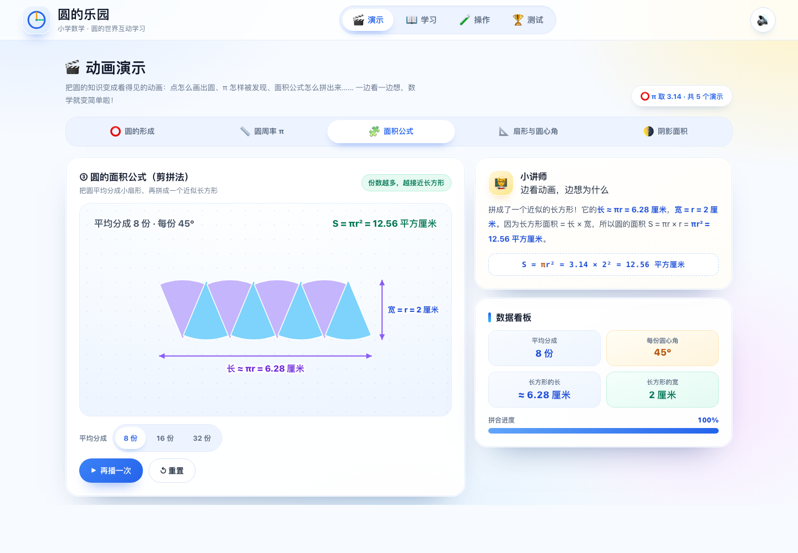

# 圆的乐园

一个给小学生学习「圆」的互动网页，覆盖**圆的概念、圆周率、1π~100π、半径与直径、圆周长、圆面积、扇形、阴影面积**。
纯 HTML / CSS / JavaScript 实现，**无任何依赖、无需联网**，双击 `index.html` 就能用。



## 打开方式

直接双击 `index.html`，或在浏览器地址栏打开：

```text
file:///Users/bing/Documents/workspeace/learning-tools/kids-circle/index.html
```

也可以在本目录启动一个本地服务器：

```bash
cd learning-tools/kids-circle
python3 -m http.server 8080
# 浏览器打开 http://127.0.0.1:8080
```

## 四个板块

### 🎬 演示：把知识「看」明白

| 演示 | 讲什么 |
| --- | --- |
| 圆是怎样形成的 | 点绕定点旋转一周形成圆，半径始终相等 |
| 圆周率 π 的发现 | 圆在直尺上滚一圈，周长 = π × 直径 |
| 圆的面积公式 | 把圆剪成扇形拼成长方形，S = πr² |
| 扇形与圆心角 | 圆心角决定扇形大小，弧长与面积随之变化 |
| 阴影面积的思路 | 圆环、外方内圆，用「挖去」「割补」理解 |

每个演示都能播放 / 暂停 / 重置，部分演示可调参数，旁边有同步讲解。

### 📖 学习：8 个知识点 + 互动小工具

1. **圆的概念** —— 圆心定位置、半径定大小，圆上各点到圆心距离相等
2. **圆周率 π** —— 周长与直径的比值，π ≈ 3.14，祖冲之的故事
3. **1π ~ 100π** —— 完整乘法表，可搜索、可隐藏答案练记忆
4. **半径与直径** —— d = 2r，滑块联动看得见
5. **圆周长** —— C = πd = 2πr，步骤化计算器 + 易错点
6. **圆面积** —— S = πr²，为什么半径翻倍面积变 4 倍
7. **扇形** —— 弧长 = 2πr × n/360，面积 = πr² × n/360
8. **阴影面积** —— 整体减空白、割补、圆环，3 道经典例题分步讲解

### 🧪 操作：自己动手做实验

- **圆规画圆工坊**：设定半径，在画布上点一下就能画出圆，实时显示 r、d、C、S
- **圆的变身计算器**：输入半径或直径，看周长、面积和完整的代入过程
- **扇形实验室**：拖动半径和圆心角，扇形、弧长、面积同步变化
- **阴影面积工坊**：圆环、外方内圆、内方外圆、半圆组合，改尺寸即时重算，可展开解题步骤

### 🏆 测试：52 道题闯关

- 题库共 52 道题，覆盖全部 8 个知识点，单选、判断、填空三种题型
- 每轮 10 题，按知识点轮转抽题；每次答题立即反馈对错，并给出分步讲解
- 结算评星（≥90% 三星、≥70% 二星），错题可回顾，最好成绩自动保存
- 支持「再来一次」，越练越熟

## 知识准确性

- 页面中所有计算统一取 **π = 3.14**（人教版小学教材惯例），结果显示最多两位小数。
- 圆周率介绍中会说明真实值 π ≈ 3.1415926…，是无限不循环小数，不要求背诵。
- 1π~100π 表由程序按 `3.14 × n` 生成，共 100 项，避免手写错误。
- 圆周长、圆面积、扇形、阴影面积公式与课本一致：
  - `d = 2r`，`C = πd = 2πr`，`S = πr²`
  - 扇形：`弧长 = 2πr × n/360`，`面积 = πr² × n/360`
  - 半圆周长 = `πr + 2r`（弧长 + 直径，易错点）
  - 圆环面积 = `π(R² − r²)`

## 文件结构

```text
kids-circle/
├── index.html          # 页面外壳：顶部导航 + 四个板块容器
├── css/
│   ├── style.css       # 设计系统、公共组件、响应式
│   ├── demo.css        # 演示板块
│   ├── learn.css       # 学习板块
│   ├── lab.css         # 操作板块
│   └── quiz.css        # 测试板块
├── js/
│   ├── core.js         # 数学/SVG/音效/存储等公共工具
│   ├── app.js          # 模式路由（#demo / #learn / #lab / #quiz）
│   ├── demo.js         # 演示板块
│   ├── learn.js        # 学习板块
│   ├── lab.js          # 操作板块
│   └── quiz.js         # 测试板块
├── preview.png         # 预览图
└── README.md
```

## 说明

- 全部图形用 SVG / Canvas 实时绘制，不加载任何图片素材。
- 支持手机、平板和电脑，触屏可直接拖动滑块、点按画布。
- 有轻量音效（可点击页面右上角关闭），动画遵循系统的「减少动态效果」偏好。
- 每个板块按需加载，切换时暂停其他板块的动画，不占后台资源。
- 无需安装、无需构建，拷走整个 `kids-circle` 文件夹即可分享。
